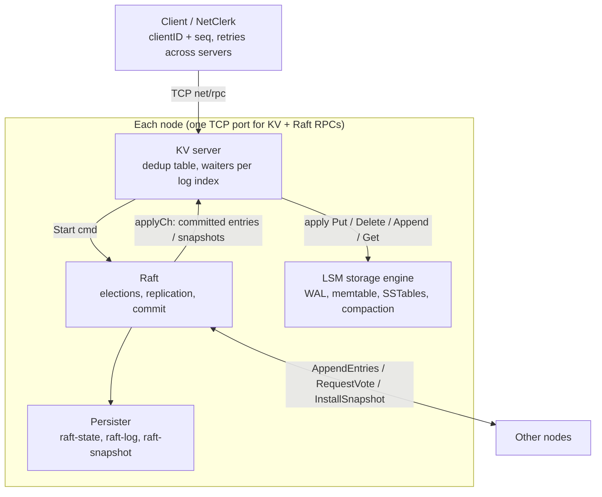
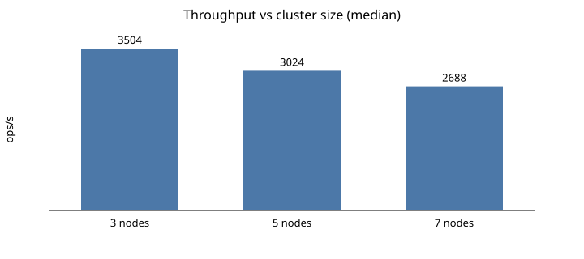
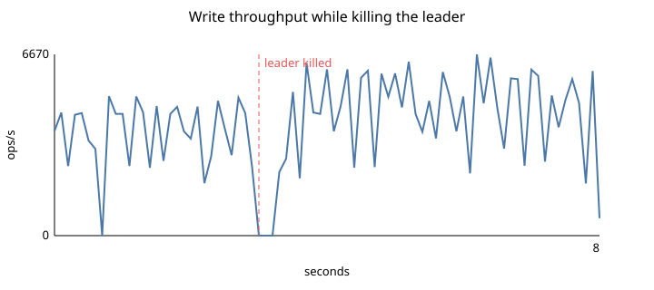

# kvraft

A distributed, linearizable key-value store in Go. Raft consensus is written from scratch and runs on top of a hand-built LSM-tree storage engine. There are no runtime dependencies outside the Go standard library; [Porcupine](https://github.com/anishathalye/porcupine) is used only in tests.

- **Storage engine:** write-ahead log with CRC32, skiplist memtable, SSTables with sparse index and bloom filter, leveled compaction.
- **Consensus:** Raft with leader election, log replication, persistence, snapshots and log compaction.
- **Service:** exactly-once client semantics over TCP, surviving leader crashes, lost replies and retries.
- **Verification:** chaos tests with partitions, crashes, packet loss and delay, checked for linearizability with Porcupine plus a replica-convergence oracle. Result: 50 runs, 0 violations.

## Architecture



A write goes like this:

1. The client sends `Put(key, value, clientID, seq)` to the node it believes is the leader.
2. The leader appends the command to its Raft log and replicates it.
3. Once a majority has the entry durably on disk, the entry commits.
4. Every node applies committed entries in log order to its storage engine.
5. The leader replies once its own apply has finished.

Reads go through the log as well, so they're linearizable without leases.

## Quick start

```
go test ./... -count=1        # full test suite, including chaos tests (a few minutes)
go run ./cmd/bench            # one-command benchmark: writes docs/results.md and charts
```

To run a 3-node cluster, use three terminals:

```
go run ./cmd/server -id 0 -peers 127.0.0.1:7000,127.0.0.1:7001,127.0.0.1:7002 -data data/node0
go run ./cmd/server -id 1 -peers 127.0.0.1:7000,127.0.0.1:7001,127.0.0.1:7002 -data data/node1
go run ./cmd/server -id 2 -peers 127.0.0.1:7000,127.0.0.1:7001,127.0.0.1:7002 -data data/node2
```

Then start the client:

```
go run ./cmd/client -peers 127.0.0.1:7000,127.0.0.1:7001,127.0.0.1:7002
> put x 1
> append x 2
> get x
```

Kill any one node: writes keep working. Kill two: writes time out instead of returning stale data, because the store chooses consistency (CP) over availability. Restart one, and writes resume.

## Design decisions

**Storage engine (`storage/`)**

- **WAL with CRC32 per record.** On recovery, a torn final write is detected and truncated rather than treated as corruption.
- **Atomic SSTable creation** by writing to `.tmp`, calling fsync, then renaming. A crash leaves either the old file set or the new one, never a half-written table.
- **Bloom filters** use double hashing with a Murmur finalizer, so most lookups for missing keys skip disk entirely.
- **Leveled compaction** uses a k-way merge with a min-heap. The newest version of a key wins, and tombstones are dropped only at the bottom level.

**Raft (`raft/`)**

- **Fast log backtracking** (ConflictTerm/ConflictIndex) means a lagging follower is repaired in one round trip per term rather than one per entry.
- **One AppendEntries in flight per peer.** Requests that arrive meanwhile are coalesced into the next RPC, which gives batching for free. It replaced an earlier design whose duplicate RPCs grew quadratically.
- **Leader group commit.** A syncer goroutine fsyncs the leader's log in batches, off the critical path, and the leader counts itself toward the majority only up to its own durable index.
- **The Figure 8 rule:** a leader commits only entries from its own term.
- **Snapshots are written by a background goroutine, outside the Raft lock.** Invariant: a node never compacts past its own durable log index, so a crash before the snapshot is saved still leaves a complete log.
- **Shadow paging for term and vote,** and an append-only log file with truncate records, compacted once it grows past 256 KB.

**KV service (`kv/`)**

- **The storage engine is a materialized view, not the source of truth.** On restart the node wipes it and rebuilds it from the Raft snapshot plus the log. Re-applying a log onto old state double-applies non-idempotent operations, which is bug story 1 below.
- **Exactly-once semantics.** Each client tags requests with `(clientID, seq)`. Every replica keeps the highest applied seq per client and skips duplicates. The dedup table is part of the snapshot, so it survives restarts and leader changes.

## Results

All numbers come from `go run ./cmd/bench` (full results in [`docs/results.md`](docs/results.md)) and the per-week reports in `docs/`. **Caveat:** every node and every client runs on one laptop, so they compete for the same CPU and disk.

| Experiment                                                                        | Result                                                                                                                                |
| --------------------------------------------------------------------------------- | ------------------------------------------------------------------------------------------------------------------------------------- |
| Linearizability under chaos (partitions, crashes, 10% packet loss, 0–25 ms delay) | 50 runs, 0 violations (Porcupine plus replica-convergence oracle)                                                                     |
| Leader failover under load, longest stretch with zero completed writes            | about 0.2–0.4 s (median of 5 runs, 3 nodes, 64 clients)                                                                               |
| Failover, time until throughput is back to 50%                                    | about 0.2–0.4 s                                                                                                                       |
| Failover runs that stalled                                                        | 0 of 40+ after the fixes below                                                                                                        |
| Throughput vs cluster size                                                        | 3 > 5 > 7 nodes in every run (quorum cost)                                                                                            |
| Absolute write throughput (3 nodes, 64 clients, 100 B puts, fsync on)             | observed from about 3K to about 45K ops/s across invocations, depending on machine power state; compare within a run, not across runs |





## Bug stories

The most instructive part of the project was the set of bugs that the tests did _not_ catch at first.

**1. Append applied twice after a restart: invisible to the linearizability checker.**
After a crash, a node replayed the Raft log on top of its old storage-engine state, so `Append` ran twice. Porcupine passed, for two reasons. It only sees responses from the leader, not the followers' internal state. And most keys received `Put`s, which overwrite and so silently healed the damage. Two test changes caught it: an **append-only key**, which never self-heals, and a **replica-convergence oracle**, which compares every replica's full state after the chaos run. The fix is the "materialized view" decision above: wipe on start, then rebuild from snapshot plus log.

**2. Failover took 1 s, and Raft wasn't the reason.**
The benchmark showed about 1.0 s of zero throughput after a leader kill, yet elections took about 250 ms. The extra time came from requests waiting on the dead leader: `Kill` stopped Raft but never woke them, so each one sat until a 1 s request timeout fired. This is a classic lost wakeup. The fix: `Kill` fails every pending waiter right away, and `submit` re-checks `killed` under the same lock, closing the check-then-register race. **Failover dropped from about 1.0 s to about 0.3 s.**

**3. A snapshot storm that left the cluster stuck after failover.**
At some snapshot intervals, the cluster stopped making progress after a leader kill: 0 writes for 15 s in 2 of 3 runs, while a leader and follower in the same term were both alive. A state dump (`DebugState`: commit, applied, persisted and snapshot indices, sampled 1 s apart) showed commits were fine but applying had nearly stopped, while the snapshot index crept up one entry at a time. The cause: the snapshot trigger compared the _whole_ log length against the limit, including committed entries not yet applied. A snapshot can only cover applied entries. So once the apply backlog alone exceeded the limit, _every_ apply triggered a full-state snapshot that trimmed one entry. Applying slowed down, the backlog grew, and the loop fed itself, much like thrashing in virtual memory. The fix was to trigger on compactable entries (`index - lastIncludedIndex`). Result: 0 stalls in 40+ failover runs, and 3.4× throughput at a 10K-entry snapshot interval. 50 linearizability-checked chaos runs had missed it, because it's a liveness bug, not a safety bug.

**4. A 169 ms fsync under the Raft lock caused spurious elections.**
Saving a snapshot inside `rf.mu` blocked heartbeats long enough for followers to time out. Moving the save to a background goroutine fixed it, but it also opened a crash window. That window is closed by the rule "never compact past the local durable index", which the tests confirmed by panicking until the rule was enforced.

**5. Disruptive rejoin.** A leader that never refreshed its own election timer would start an election the moment it stepped down after a partition, which disrupted the healthy majority. The regression test was first verified to fail without the fix.

## Known limitations

- **No Pre-Vote.** A partitioned node keeps incrementing its term and disrupts the cluster when it rejoins. Term inflation from about 160 to 280 was observed in chaos runs. Pre-Vote (Raft thesis §9.6) is the standard fix.
- **Single-machine benchmarks.** CPU and disk contention dominate. On separate machines, network round trips would dominate instead, and the quorum cost of larger clusters would look different.
- **Failover time grows with follower apply lag.** A new leader answers clients only after applying its backlog. At high write rates, followers lagged 50–100K entries behind, which stretched failover to about 0.9 s. Production systems bound this with flow control on the apply queue.
- **The applied index isn't persisted.** A restart wipes the storage engine and replays from the last snapshot. Persisting the applied index alongside the engine would avoid the full replay.
- **No cluster membership changes** and no lease-based reads. Every read goes through the log.
- Developed and measured on Windows. `renameWithRetry` works around Windows refusing to rename a file while another handle has it open.

## Repository layout

```
storage/     LSM engine: wal.go, memtable.go, sstable.go, bloom.go, merge.go, engine.go
raft/        raft.go, persist.go, transport_tcp.go, memnet.go (in-memory chaos network), tests
kv/          server.go, client.go, netclerk.go, rpc.go, chaos_test.go (Porcupine + convergence oracle)
cmd/server   one node: Raft + KV on one TCP port
cmd/client   interactive CLI
cmd/bench    benchmark: throughput vs cluster size, failover under load, SVG charts
docs/        results.md, charts, per-week benchmark reports
```

## Concepts covered

| Area                                                 | Where it shows up                                                                                  |
| ---------------------------------------------------- | -------------------------------------------------------------------------------------------------- |
| DBMS: write-ahead logging, checkpoints, recovery     | WAL, Raft log + snapshots (snapshot = checkpoint, log tail = redo log), snapshot-interval tradeoff |
| DBMS: indexing, B-trees vs LSM                       | SSTables, sparse index, bloom filters, compaction                                                  |
| OS: synchronization, condition variables, deadlock   | applier `sync.Cond` (Mesa semantics), lock ordering, lost wakeup (bug 2), thrashing (bug 3)        |
| OS: file systems, durability                         | fsync, atomic rename, shadow paging                                                                |
| CN: TCP, timeouts, retries                           | net/rpc transport, per-RPC timeouts, client failover                                               |
| Algorithms: heaps, hashing, probabilistic structures | k-way merge with a min-heap, skiplist, bloom filter                                                |
