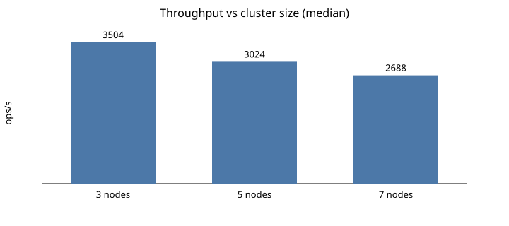
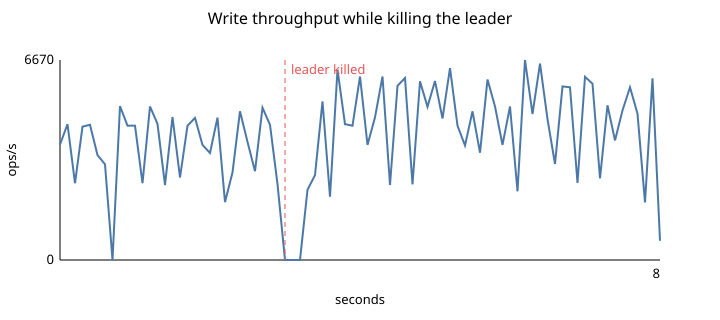

# kvraft benchmark results

Generated by `go run ./cmd/bench` on 2026-11-25. Full stack: TCP clients, Raft with fsync, snapshot every 100000 entries, exactly-once. Each number is the median of 5 runs (min–max in brackets).

**Caveat:** all nodes and all clients run on one laptop, so they compete for the same CPU and disk. Absolute throughput varies by up to about 3x between invocations (power and thermal state); compare numbers within one run, not across runs.

## Throughput vs cluster size (64 clients, 100 B puts, 5s per run)

| Nodes | Tolerates failures | ops/s | mean latency | p99 latency | elections during load |
|---|---|---|---|---|---|
| 3 | 1 | 3504 (3359–4067) | 18.3 ms (15.7 ms–19.1 ms) | 48.2 ms (39.7 ms–66.1 ms) | 0 (0–0) |
| 5 | 2 | 3024 (2987–3177) | 21.2 ms (20.1 ms–21.4 ms) | 53.3 ms (51.3 ms–58.9 ms) | 0 (0–0) |
| 7 | 3 | 2688 (2500–2756) | 23.8 ms (23.2 ms–25.6 ms) | 62.7 ms (57.6 ms–127.1 ms) | 0 (0–0) |

## Failover under load (3 nodes, 64 clients, leader killed at t=3 s)

| Metric | Result |
|---|---|
| Longest stretch with zero completed writes (5 s window) | 280.3 ms (211.6 ms–369.1 ms) |
| Time until throughput is back to 50% of normal | 298.0 ms (199.4 ms–397.3 ms) (100 ms resolution, runs that got there) |
| Runs where writes resumed but stayed below 50% until the end | 0 of 5 |
| Runs stuck (no write for the whole 5 s window) | 0 of 5 |

